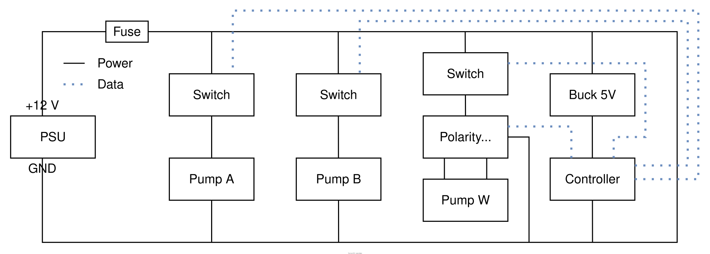

# project-basil

An automated hydroponic basil farm.

## Overview

### Requirements

Hydroponic growth requires:

| Requirement | Description                                                                                  |
| ----------- | -------------------------------------------------------------------------------------------- |
| Solution    | Water and nutrients, typically supplied in two parts that must not mix at high concentration |
| Air         | Oxygen at the roots to sustain growth and prevent root rot                                   |
| Light       | 14-16 hours per day, followed by 8-10 hours of darkness                                      |
| Heat        | Above 10C, ideally 20-27C, and no higher than 30C                                            |

Optimal growth requires all four to be controlled. As basil grows (non-optimally) at room temperature, this project is currently limited to solution, air, and light.

### Additional considerations

A practical system must also manage:

| Consideration                      | Effect                               |
| ---------------------------------- | ------------------------------------ |
| Algae                              | Competes for nutrients, clogs tubing |
| Evaporation                        | Level drops, roots exposed           |
| Leaks and electrical safety        | Water damage, electric shock         |
| Root growth                        | Drain intake blocked                 |
| Nutrient depletion                 | Solution weakens over time           |
| pH drift                           | Reduced nutrient uptake              |
| Tubing wear                        | Reduced flow, leaks                  |
| Power cuts                         | Aeration stops, cycle interrupted    |
| Loop feedback and control accuracy | Dosing errors, undetected faults     |

## Design

Each requirement is managed by an independent control, and the three run in parallel: a drain, refill, and dosing cycle for solution; continuous aeration for air; and a timed grow light for light.

### Solution

The system routinely:

1. Drains the tank to waste
2. Starts the water pump
3. Doses part A for a set time
4. Doses part B for a set time
5. Flushes the tubing
6. Stops the water pump

### Air

An air pump and air stone oxygenate the water beneath the roots.

### Light

A timer-controlled LED grow light provides the required light period.

### Mitigations

| Consideration                      | Mitigation                                     |
| ---------------------------------- | ---------------------------------------------- |
| Algae                              | Opaque reservoir, tubing, and fittings         |
| Evaporation                        | Regular full refill; level sensor (planned)    |
| Leaks and electrical safety        | Electronics mounted above water (planned)      |
| Root growth                        | Mesh filter on drain intake                    |
| Nutrient depletion                 | Regular full refill                            |
| pH drift                           | Regular full refill                            |
| Tubing wear                        | Periodic replacement of pump tubing            |
| Power cuts                         | Safe restart on power-up (planned)             |
| Loop feedback and control accuracy | Pump calibration; functional sensors (planned) |

## Parts

| ID  | Part                        | Spec                                        | Qty |
| --- | --------------------------- | ------------------------------------------- | --- |
| 01  | Net pot                     |                                             | 1   |
| 02  | Substrate                   | Clay pebbles                                | –   |
| 03  | DWC reservoir               | 3 L, opaque                                 | 1   |
| 04  | A and B reservoirs          | Original nutrient bottles, tube through cap | 2   |
| 05  | Water reservoir             |                                             | 1   |
| 06  | Waste reservoir             |                                             | 1   |
| 07  | Tubing                      | Opaque                                      | –   |
| 08  | Barbed tee                  | Opaque                                      | 2   |
| 09  | Check valve                 | Opaque                                      | 2   |
| 10  | Peristaltic pump            | Adjustable, 10–20 ml/min                    | 2   |
| 11  | Reversible peristaltic pump | ≥500 ml/min                                 | 1   |
| 12  | Air pump                    |                                             | 1   |
| 13  | Air stone                   | Flat-based, circular                        | 1   |
| 14  | Mesh filter                 |                                             | 1   |

## Plumbing

## Wiring

