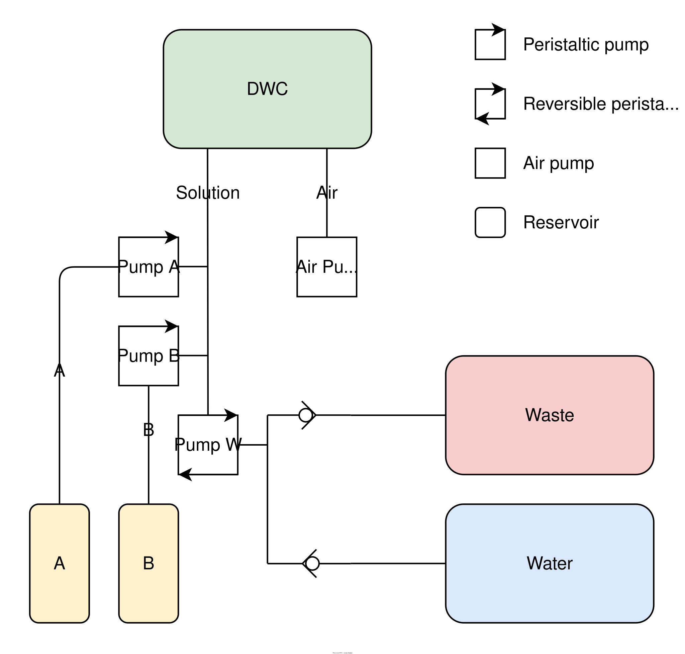

# project-basil

Automated hydroponic basil farm.

### Plumbing
 

| ID  | Part                        | Spec                                        | Qty |
| --- | --------------------------- | ------------------------------------------- | --- |
| 01  | Net pot                     |                                             | 1   |
| 02  | Substrate                   | Clay pebbles                                | –   |
| 03  | DWC reservoir               | 3 L, opaque                                 | 1   |
| 04  | A and B reservoirs          | Original nutrient bottles, tube through cap | 2   |
| 05  | Water reservoir             |                                             | 1   |
| 06  | Waste reservoir             |                                             | 1   |
| 07  | Tubing                      | Opaque                                      | –   |
| 08  | Barbed tee                  | Opaque                                      | 2   |
| 09  | Check valve                 | Opaque                                      | 2   |
| 10  | Peristaltic pump            | Adjustable, 10–20 ml/min                    | 2   |
| 11  | Reversible peristaltic pump | ≥500 ml/min                                 | 1   |
| 12  | Air pump                    |                                             | 1   |
| 13  | Air stone                   | Flat-based, circular                        | 1   |
| 14  | Mesh filter                 |                                             | 1   |

## Plumbing

